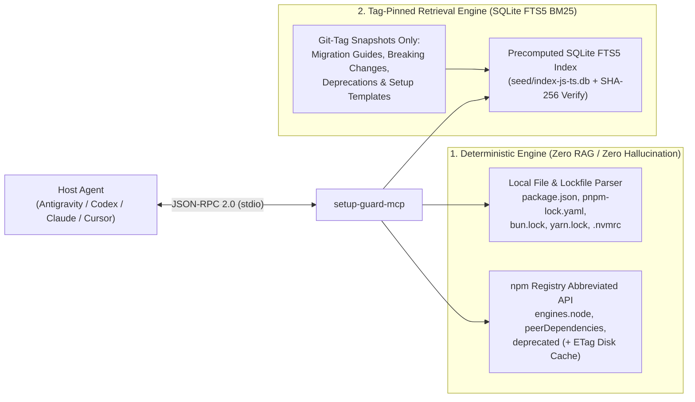

# setup-guard-mcp

> **"Your agent reads the wrong docs. `setup-guard` makes it read the right version."**

[](./LICENSE)
[](https://nodejs.org/)
[](https://modelcontextprotocol.io/)
[](#1-why-setup-guard-mcp)

**Version-Aware Setup, Dependency Compatibility & Migration MCP Server for the JS/TS Ecosystem.**

`setup-guard-mcp` is a zero-config, local Model Context Protocol (MCP) server that prevents AI coding agents (**Google Antigravity**, **OpenAI Codex**, **Claude Code**, **Cursor**, **Windsurf**) from hallucinating obsolete configurations, incompatible dependency versions, or mismatched package manager commands.

Instead of acting as a generic documentation search engine, `setup-guard-mcp` grounds your agent in your project's **actual dependency graph, lockfile, runtime version, and configuration paradigm**—combining deterministic local/registry verification with tag-pinned official migration guides.

---

## Table of Contents

1. [Why `setup-guard-mcp`?](#1-why-setup-guard-mcp)
2. [Core Architecture](#2-core-architecture)
3. [Quick Start & Host Agent Configuration](#3-quick-start--host-agent-configuration)
   - [Google Antigravity (AGY)](#a-google-antigravity-agy)
   - [OpenAI Codex (CLI & Desktop App)](#b-openai-codex-cli--desktop-app)
   - [Claude Code & Claude Desktop](#c-claude-code--claude-desktop)
   - [Cursor](#d-cursor)
4. [MCP Tools Reference (5 Tools)](#4-mcp-tools-reference-5-tools)
5. [Supported Ecosystem (Phase 1)](#5-supported-ecosystem-phase-1)
6. [Safety & Epistemic Guardrails](#6-safety--epistemic-guardrails)
7. [Testing with MCP Inspector & Evaluation Suite](#7-testing-with-mcp-inspector--evaluation-suite)
8. [Repository Structure](#8-repository-structure)
9. [License](#9-license)

---

## 1. Why `setup-guard-mcp`?

Because LLM pre-training weights are frozen at a cutoff date, coding agents routinely make costly setup and migration errors:

- **Tailwind CSS v4 vs. v3**: Suggesting `npx tailwindcss init -p`, `tailwind.config.js`, and `@tailwind base;` in a **Tailwind CSS v4** project (which uses `@import "tailwindcss";` and `@tailwindcss/vite` or `@tailwindcss/postcss`).
- **ESLint v9 vs. v8**: Generating legacy `.eslintrc.json` or `.eslintignore` files in an **ESLint v9** project that requires `eslint.config.mjs` (Flat Config) and `typescript-eslint`.
- **Next.js 15 & React 19**: Using synchronous `cookies()`, `headers()`, or `params` in **Next.js 15** (where Dynamic Request APIs are asynchronous `Promise`s), or proposing incompatible React 18 / Node.js combinations.
- **Package Manager Mismatch**: Suggesting `npm install` in a repository locked with `pnpm-lock.yaml`, `bun.lock`, or `yarn.lock`.

`setup-guard-mcp` eliminates these failure modes **without requiring any LLM API keys or remote servers**.

---

## 2. Core Architecture



### Key Architectural Decisions

1. **Strict Separation of Structured vs. Unstructured Data**
   - **Structured Data (Deterministic)**: Local files (`package.json`, lockfiles, `.nvmrc`, `tsconfig.json`, `eslint.config.*`) and npm registry metadata (`engines`, `peerDependencies`, `deprecated` via `Accept: application/vnd.npm.install-v1+json`) are evaluated deterministically using `semver`. RAG is never used where exact logic applies.
   - **Unstructured Docs (Indexed Retrieval)**: Only official migration guides, release note breaking-change sections, and deprecation notices pinned to immutable Git tags (e.g., `v15.0.3`, `v4.0.0`, `v9.14.0`) are indexed.
2. **Zero-Config & Precomputed Index Distribution**
   - Document chunking and SQLite FTS5 indexing happen in CI/build (`indexer/build.ts`), producing a self-contained `seed/index-js-ts.db` verified by SHA-256 (`seed/manifest.json`).
   - Built on Node.js native `node:sqlite` (`DatabaseSync` with `FTS5` and `unicode61 tokenchars '@/_-.'`)—zero native C++ compilation (`node-gyp`) failures during `npx` execution.
3. **Strict `stdio` Protocol Hygiene**
   - In `stdio` MCP servers, `stdout` is strictly reserved for JSON-RPC 2.0 frames. `setup-guard-mcp` intercepts accidental `console.log` calls and routes all internal diagnostics exclusively to `process.stderr` only when `DEBUG="true"` is set.

---

## 3. Quick Start & Host Agent Configuration

### Prerequisites
- **Node.js**: `>= 22.5.0` (uses built-in `node:sqlite`)

### A. Google Antigravity (AGY)

**Option 1: Global MCP Configuration (`~/.gemini/config/mcp_config.json`)**
```json
{
  "mcpServers": {
    "setup-guard": {
      "command": "npx",
      "args": ["-y", "setup-guard-mcp"],
      "env": {
        "SETUP_GUARD_OFFLINE": "0"
      }
    }
  }
}
```
*(If running from a local clone, set `"command": "node"` and `"args": ["/absolute/path/to/Version-Aware-Setup/dist/index.js"]`.)*

**Option 2: Native Antigravity Workspace Plugin & Rules**
This repository ships with:
- [`.agents/plugins/setup-guard/`](./.agents/plugins/setup-guard/) (`plugin.json`, `mcp_config.json`, `skills/setup-guard/SKILL.md`) — automatically discovered by Antigravity and invokable via `/setup-guard`.
- [`GEMINI.md`](./GEMINI.md) — workspace rule that instructs Antigravity to run `detect_project_environment` before proposing setup commands.

---

### B. OpenAI Codex (CLI & Desktop App)

**Option 1: Register via CLI**
```bash
codex mcp add setup-guard -- npx -y setup-guard-mcp
```

**Option 2: Configure `~/.codex/config.toml`**
```toml
[mcp_servers.setup-guard]
command = "npx"
args = ["-y", "setup-guard-mcp"]
startup_timeout_sec = 15
tool_timeout_sec = 30
enabled = true

[mcp_servers.setup-guard.env]
SETUP_GUARD_OFFLINE = "0"
```
This repository also includes [`AGENTS.md`](./AGENTS.md) so Codex automatically follows the version-aware verification workflow.

---

### C. Claude Code & Claude Desktop

**Claude Code CLI:**
```bash
claude mcp add setup-guard -- npx -y setup-guard-mcp
```

**Claude Desktop (`claude_desktop_config.json`):**
```json
{
  "mcpServers": {
    "setup-guard": {
      "command": "npx",
      "args": ["-y", "setup-guard-mcp"]
    }
  }
}
```

---

### D. Cursor

Add to `.cursor/mcp.json` (project) or `~/.cursor/mcp.json` (global):
```json
{
  "mcpServers": {
    "setup-guard": {
      "command": "npx",
      "args": ["-y", "setup-guard-mcp"]
    }
  }
}
```

---

## 4. MCP Tools Reference (5 Tools)

### 1. `detect_project_environment`
Inspects local project files without making any network requests.
- **Input**:
  - `project_path` (`string`, required): Absolute path to the project root containing `package.json`.
- **Detects**:
  - **Runtime**: `.nvmrc` > `.node-version` > `package.json#volta.node` > `.tool-versions` > `package.json#engines.node`
  - **Package Manager**: `package.json#packageManager` > `pnpm-lock.yaml` > `bun.lock`/`bun.lockb` > `yarn.lock` (distinguishes Yarn Classic v1 vs. Berry v2+) > `package-lock.json`, plus exact CLI command templates (`pnpm add -D`, `pnpm dlx`, `bunx`, etc.)
  - **Locked Dependency Versions**: Resolves actual installed versions via `node_modules/<pkg>/package.json` > Lockfile > `pnpm-workspace.yaml` catalog > `package.json`
  - **Config Paradigms**: ESLint (`flat_config` vs. `legacy_eslintrc`), Tailwind CSS (`v4_css_first` vs. `v3_config_file`), Next.js (`app_router` / `pages_router` / `hybrid`), TypeScript (`tsconfig.json`), and Vite (`vite.config.*`).

### 2. `check_dependency_compatibility`
Deterministically validates cross-package compatibility against the npm registry (`Accept: application/vnd.npm.install-v1+json`) with local disk + ETag caching.
- **Input**:
  - `dependencies` (`Record<string, string>`, required): Production dependency map (e.g., `{"next": "15.0.3", "react": "18.2.0"}`).
  - `devDependencies` (`Record<string, string>`, optional): Dev dependency map (e.g., `{"eslint": "9.14.0"}`).
  - `runtime_version` (`string`, optional): Target Node.js version (e.g., `"18.17.0"`).
- **Output**:
  - `status`: `"ok"` | `"conflict"` | `"warning"` | `"unverified"`
  - Detailed `issues` (`engine_mismatch`, `peer_dependency_conflict`, `missing_peer_dependency`), `deprecations`, and `unverified` items (such as `workspace:*` or `catalog:` specifiers) with official npm registry `source_url` links.

### 3. `get_versioned_setup_guide`
Returns citation-backed installation commands (translated to the project's package manager), configuration file templates, and obsolete patterns to avoid.
- **Input**:
  - `library` (`string`, required): Supported library name (`tailwindcss`, `eslint`, `nextjs`, `vite`, `react`, `typescript`, `node`).
  - `target_version` (`string`, required): Explicit target version or single-major range (e.g., `"4.0.0"`, `"9.14.0"`).
  - `package_manager` (`"npm" | "pnpm" | "yarn" | "bun"`, required)
  - `runtime_version` (`string`, optional)
  - `framework_context` (`"nextjs" | "vite" | "react" | "postcss" | "standalone"`, optional)

### 4. `get_upgrade_steps`
Retrieves ordered migration steps, breaking changes, and official codemod commands between two versions (`from_version` → `to_version`).
- **Input**:
  - `library` (`string`, required)
  - `from_version` (`string`, required): Current version (e.g., `"3.4.1"`, `"8.57.0"`, `"14.2.0"`).
  - `to_version` (`string`, required): Target version (e.g., `"4.0.0"`, `"9.14.0"`, `"15.0.3"`).
  - `focus_area` (`string`, optional): Filter by topic or API (e.g., `"cookies"`, `"flat config"`, `"caching"`).
  - `package_manager` (`"npm" | "pnpm" | "yarn" | "bun"`, optional)

### 5. `search_versioned_docs`
Executes a weighted SQLite FTS5 BM25 query (`bm25(doc_chunks_fts, 5.0, 3.0, 1.0)`) with two-pass `AND` → `OR` fallback against tag-pinned documentation chunks.
- **Input**:
  - `library` (`string`, required)
  - `query` (`string`, required): Symbol, config key, or migration concept (e.g., `"async cookies headers"`, `"@theme"`, `"FlatCompat"`).
  - `version` (`string`, optional): Target version. If omitted, `project_path` must be supplied to resolve the version from the project's lockfile/`package.json`.
  - `project_path` (`string`, optional)
  - `doc_types` (`Array<"migration_guide" | "release_note" | "deprecation" | "setup_guide">`, optional)
  - `top_k` (`number`, optional, default `5`)

---

## 5. Supported Ecosystem (Phase 1)

| Category | Supported Targets |
| :--- | :--- |
| **Libraries (7)** | `node`, `typescript`, `react`, `nextjs`, `vite`, `tailwindcss`, `eslint` |
| **Package Managers (4)** | `npm`, `pnpm`, `yarn` (Classic v1 & Berry v2+), `bun` |
| **Core Scenarios** | • Tailwind CSS v3 → v4 (`@import "tailwindcss"`, `@tailwindcss/vite`, `@theme`)<br/>• ESLint v8 → v9 (`eslint.config.mjs` Flat Config, `typescript-eslint`)<br/>• Next.js 14 → 15 & React 18 → 19 (`async` Request APIs, caching defaults, peer dependencies)<br/>• Vite v5 → v6 & TypeScript v5 setup/migration |

---

## 6. Safety & Epistemic Guardrails

`setup-guard-mcp` enforces strict epistemic boundaries to prevent downstream agent hallucinations:

1. **No Silent `"latest"` Substitution (`status: "ambiguous_version"`)**: When a version is omitted without a `project_path`, or when a range spans multiple majors (e.g., `>=13.0.0 <16.0.0` or `*`), the server refuses to guess `"latest"` and returns candidate versions for confirmation.
2. **Zero Search Results ≠ Feature Removed (`status: "no_results_found"`)**: Because the corpus only indexes migration, deprecation, and breaking-change docs (excluding general tutorials/API references), `0` search matches returns `epistemic_notice: "NO_EVIDENCE_DO_NOT_ASSUME_REMOVED"`.
3. **Explicit Unsupported Scope (`status: "unsupported_library"`)**: Queries for libraries outside the 7 supported targets immediately return `"unsupported_library"` with the supported list.
4. **Read-Only Execution Boundary**: CLI commands and codemods are returned as structured data with `source_url` citations; the MCP server never executes shell commands or modifies user files.

---

## 7. Testing with MCP Inspector & Evaluation Suite

### Build & Run Locally

```bash
# 1. Install dependencies
npm install

# 2. Compile TypeScript & build the SQLite FTS5 seed index
npm run build

# 3. Run the integration test suite (Vitest)
npm test

# 4. Run the golden dataset retrieval & guardrail benchmark
npm run eval
```

### Protocol Verification with Official MCP Inspector

You can inspect and test all 5 tools interactively or via CLI using `@modelcontextprotocol/inspector`:

```bash
# Launch the interactive MCP Inspector Web UI
npm run inspect

# Run headless CLI verification (list tools)
npm run inspect:cli

# Call a specific tool over MCP Inspector CLI
npx -y @modelcontextprotocol/inspector --cli node dist/index.js \
  --method tools/call \
  --tool-name detect_project_environment \
  --tool-arg project_path="$(pwd)"
```

### Retrieval & Guardrail Benchmark Results (`npm run eval`)

Evaluated against [`eval/golden-dataset.jsonl`](./eval/golden-dataset.jsonl):

| Metric | Target | Result |
| :--- | :--- | :--- |
| **`Recall@1`** | `>= 0.70` | **`1.000`** |
| **`Recall@5`** | `>= 0.90` | **`1.000`** |
| **`MRR@10`** | `>= 0.80` | **`1.000`** |
| **`Version Leakage Rate`** | `0.00` | **`0.000`** (0 cross-major chunk leaks) |
| **`Guardrails Passed`** | `100%` | **`true`** (`ambiguous_version`, `unsupported_library`, `no_results_found`) |

---

## 8. Repository Structure

```text
Version-Aware-Setup/
├── src/
│   ├── index.ts                     # CLI entrypoint (stdio MCP transport)
│   ├── server.ts                    # McpServer initialization & tool registration
│   ├── types/                       # TypeScript interfaces & Zod schemas
│   ├── detectors/                   # Deterministic parsers (PM, lockfiles, runtime, configs)
│   ├── compatibility/               # npm registry client (ETag cache) & semver resolver
│   ├── retrieval/                   # Node native SQLite FTS5 (BM25) search engine
│   ├── cache/                       # ~/.cache/setup-guard-mcp manager & SHA-256 verifier
│   ├── tools/                       # 5 MCP tool handlers
│   └── utils/                       # stderr-only logger & version range analyzer
├── indexer/                         # Markdown AST chunker & SQLite FTS5 index builder
├── sources/js-ts.sources.yaml       # Tag-pinned official documentation manifest
├── seed/                            # Precomputed SQLite FTS5 index & SHA-256 manifest
├── eval/                            # Golden dataset (JSONL) & quantitative benchmark runner
├── tests/                           # Vitest integration tests
├── ci/workflows/                    # GitHub Actions workflow for index building & verification
├── .agents/plugins/setup-guard/     # Native Google Antigravity plugin & skill bundle
├── AGENTS.md                        # Agent instructions for OpenAI Codex & compatible hosts
├── GEMINI.md                        # Workspace rule for Google Antigravity
└── LICENSE                          # MIT License
```

---

## 9. License

This project is licensed under the [MIT License](./LICENSE).
